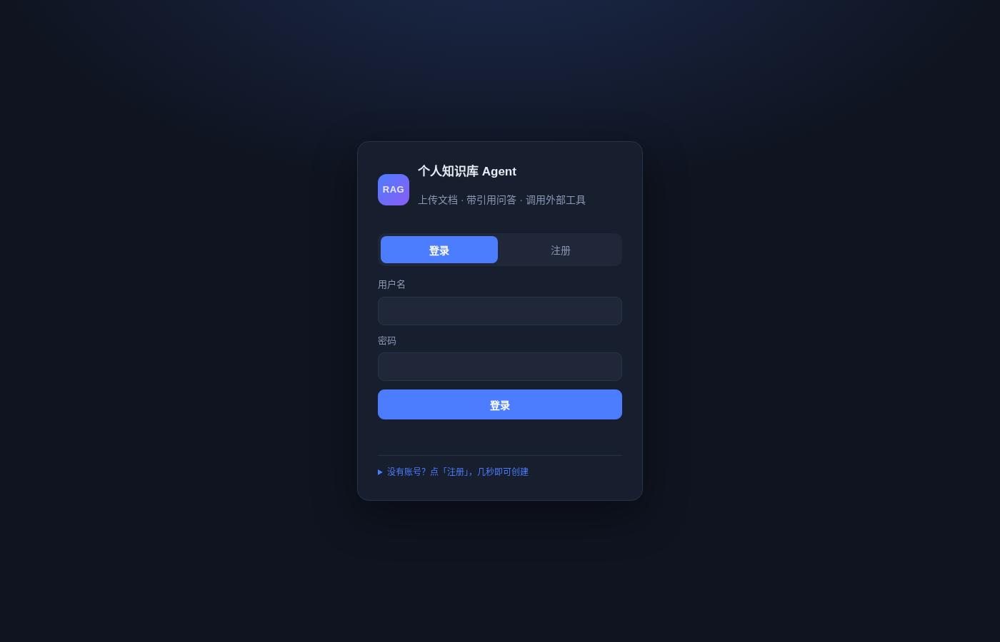
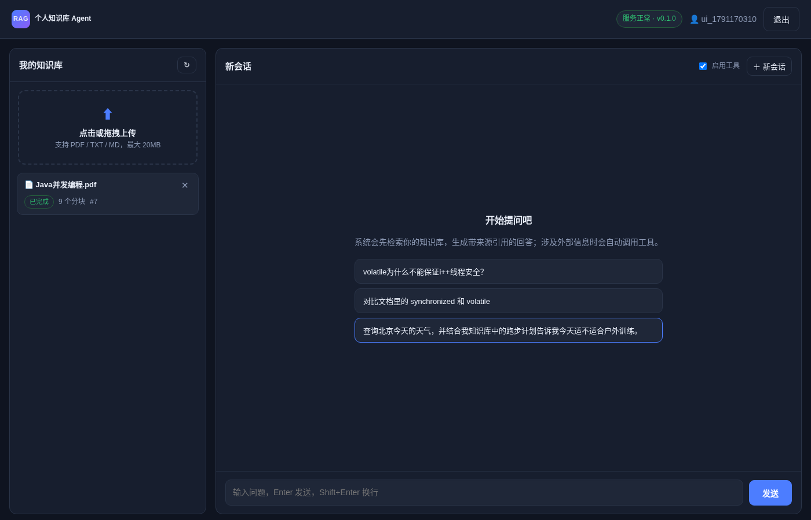
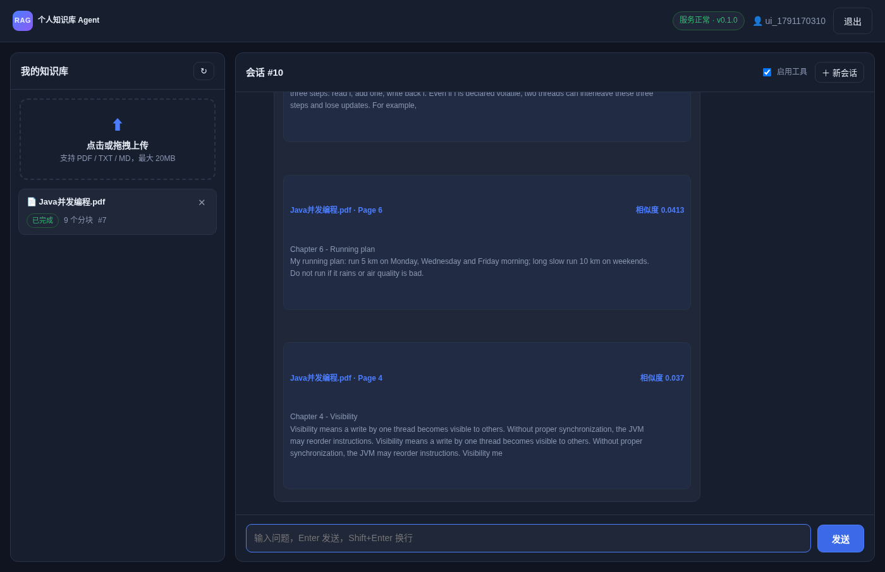
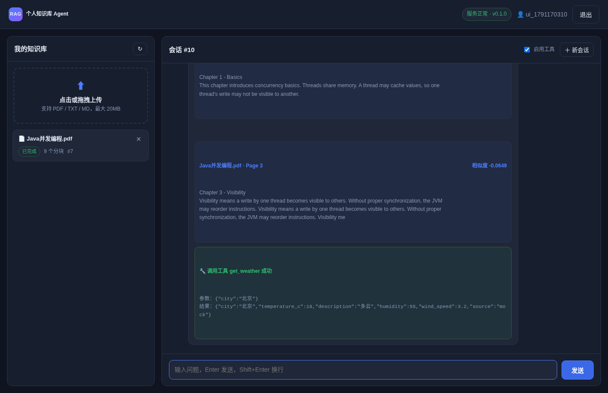

# RAG Agent · 个人知识库助手

一个**打开浏览器就能用**的 Agent 应用：上传个人文档 → 自动建知识库 → 带来源引用的对话问答 → 需要时自动调用外部工具。

默认配置**完全离线可跑**（哈希向量 + mock 大模型 + mock 天气），不需要任何 API Key，启动后就能在网页里完整走一遍真实流程。

> 这是「先看到完整产品，再决定学什么」的第一阶段产物。

---

## 一、30 秒跑起来

```bash
cd /home/nay/final/rag
docker compose up -d --build
```

然后浏览器打开：

### 👉 http://localhost:8000

看到登录页就成功了。

要停止：

```bash
docker compose down        # 停止
docker compose down -v     # 停止并清空数据
```

---

## 二、浏览器里的完整操作流程

### 第 1 步 · 注册并登录

打开 http://localhost:8000 ，在登录卡片点 **「注册」** 标签：

- 用户名：任意 ≥3 位，例如 `demo`
- 密码：任意 ≥6 位，例如 `demo123456`
- 点 **「注册并登录」**

注册成功会自动登录并进入主界面。

> 已经有账号就切回「登录」标签，填同样的用户名密码即可。登录状态保存在浏览器里，刷新页面不会退出。



---

### 第 2 步 · 上传文档，建立知识库

进入主界面后，左侧是 **「我的知识库」**。

1. 点击 **虚线框「点击或拖拽上传」**，选择 `samples/Java并发编程.pdf`
   （或拖拽文件进虚线框；支持 PDF / TXT / MD，最大 20MB）
2. 页面提示 **「文件已上传，正在处理。」**
3. 文档卡片状态自动变化：**排队中 → 处理中 → 已完成**

状态 **已完成** 后，右侧会显示分块数量，说明后台已完成：

```text
解析 → 切块 → embedding → 入库 → 可检索
```

> 这里用了真实的异步处理：上传立即返回，后台线程解析并向量化，前端每 4 秒自动刷新状态。上传一个较大的 PDF 时能明显看到状态从「处理中」变到「已完成」。



想删掉某个文档？点卡片右上角的 **✕** 即可。

---

### 第 3 步 · 带来源引用的问答（RAG）

在右侧对话框输入（也可以点下面的示例问题）：

```text
volatile为什么不能保证i++线程安全？
```

按 **Enter** 发送（Shift+Enter 换行）。系统会：

1. 把你的问题向量化；
2. 在知识库里做**语义检索**，找到最相关的分块；
3. 把检索结果交给大模型组织答案；
4. 在回答下方附上 **「📎 来源引用」**：文件名、Page 页码、原文片段、相似度分数。

这就是一个真正的 RAG 问答：**回答有出处，可追溯。**



继续追问，它会记得上下文：

```text
对比文档里的 synchronized 和 volatile
```

每次追问都会带上同一会话的历史消息，实现多轮对话。点右上角 **「＋ 新会话」** 可以开启一个全新上下文。

---

### 第 4 步 · 让 Agent 自动调用外部工具

输入一个**知识库里没有、需要外部信息**的问题：

```text
查询北京今天的天气，并结合我知识库中的跑步计划告诉我今天适不适合户外训练。
```

这时 Agent 不会硬答，而是自己判断：**这个问题需要查天气** → 调用 `get_weather` 工具 → 拿到天气数据 → 同时检索知识库里的跑步计划 → 综合两部分给出回答。

回答下方会出现绿色的 **「🔧 调用工具 get_weather 成功」** 卡片，展开能看到工具收到的参数和返回结果。



右上角有一个 **「启用工具」** 开关：关掉它再问同样的问题，Agent 就只做知识库问答、不再调用工具，方便对比观察工具调用前后的差别。

---

## 三、一套自动化验证（可选）

如果不想手点，可以用脚本跑完整流程。

**浏览器级 E2E**（真实 Chromium 打开页面、注册、上传、提问、截图）：

```bash
pip install playwright && playwright install chromium   # 首次
BASE=http://localhost:8000 python scripts/browser_check.py
```

会依次验证：登录页渲染 → 注册登录 → 网页上传 → 状态变「已完成」 → RAG 引用 → 工具调用 → 刷新保持登录，并把截图存到 `screenshots/`。

**接口级 smoke test**：

```bash
BASE=http://localhost:8000 python scripts/smoke_test.py
```

**单元 / 集成测试**：

```bash
make test        # 或 pytest -q
# 16 passed
```

---

## 四、本地开发（不用 Docker）

```bash
cd /home/nay/final/rag
python3 -m venv .venv && source .venv/bin/activate
pip install -r requirements.txt
cp .env.example .env
uvicorn app.main:app --reload --port 8000
```

浏览器打开 http://localhost:8000 即可，界面和 Docker 版完全一样。

常用命令：

```bash
make install    # 装依赖
make run        # 启动开发服务
make test       # 跑测试
make smoke      # 跑接口 smoke（需服务已启动）
```

---

## 五、切换到真实大模型 / 真实天气

默认是离线 mock，所以任何机器都能直接跑通演示。要接真实能力，**只改 `.env`，代码一行不动**：

```dotenv
# 真实 LLM（OpenAI / DeepSeek / Qwen / 本地 vLLM 等任意 OpenAI 兼容接口）
LLM_PROVIDER=openai
LLM_BASE_URL=https://api.deepseek.com/v1
LLM_MODEL=deepseek-chat
LLM_API_KEY=sk-xxxx

# 真实 Embedding
EMBEDDING_PROVIDER=openai
EMBEDDING_BASE_URL=https://api.openai.com/v1
EMBEDDING_MODEL=text-embedding-3-small
EMBEDDING_API_KEY=sk-xxxx

# 真实天气（不填则用离线 mock 天气）
WEATHER_API_KEY=your-openweathermap-key
```

Docker 下直接用环境变量注入：

```bash
LLM_PROVIDER=openai LLM_API_KEY=sk-xxx docker compose up -d
```

改完刷新浏览器即可，界面无需重新构建。

---

## 六、能力清单

| 模块 | 实现 |
|---|---|
| 浏览器界面 | 原生 HTML/CSS/JS 单页应用，登录、上传、对话、引用、工具调用全图形化 |
| 用户系统 | 注册 / 登录 / JWT 鉴权，前端记住登录态 |
| 文档上传 | 点击或拖拽上传，类型与大小校验 |
| 文档解析 | PDF（含**页码**）/ TXT / Markdown |
| 异步处理 | 上传即返回 `202`，后台解析，前端自动轮询状态 |
| 切块 | 按字符滑窗 + 段落/句子边界，保留页码 |
| Embedding | 抽象层：`hash`（离线默认） / `openai`（OpenAI 兼容） |
| 向量检索 | 向量存 SQLite + 余弦相似度检索（接口可替换 pgvector/Qdrant） |
| RAG 问答 | 检索 Top-K → LLM 生成 → **来源引用（文件名 + 页码 + 原文 + 分数）** |
| 多轮对话 | 会话与消息落库，带上下文；可新建会话 |
| Agent 工具调用 | `get_weather` 工具，模型自行决定是否调用；界面可开关、可见调用详情 |
| 日志 | 控制台 + `logs/app.log`（轮转） |
| 测试 | pytest 16 用例 + 接口 smoke + 浏览器 E2E |
| Docker | 一键启动，服务内置健康检查 |

---

## 七、API 一览（前端已经全部封装好）

| 方法 | 路径 | 说明 | 鉴权 |
|---|---|---|---|
| GET | `/` | 浏览器 Web 界面 | 否 |
| GET | `/health` | 健康检查 | 否 |
| POST | `/auth/register` | 注册 | 否 |
| POST | `/auth/login` | 登录，返回 JWT | 否 |
| GET | `/auth/me` | 当前用户 | 是 |
| POST | `/documents/upload` | 上传文档 | 是 |
| GET | `/documents` | 文档列表与状态 | 是 |
| GET | `/documents/{id}` | 文档详情 | 是 |
| DELETE | `/documents/{id}` | 删除文档 | 是 |
| POST | `/chat` | 提问（RAG + Agent） | 是 |
| GET | `/chat/conversations` | 会话列表 | 是 |
| GET | `/chat/conversations/{id}/messages` | 会话消息 | 是 |
| GET | `/docs` | 交互式 API 文档（Swagger） | 否 |

`POST /chat` 响应示例：

```json
{
  "conversation_id": 1,
  "answer": "...",
  "citations": [
    {"document_id": 1, "filename": "Java并发编程.pdf", "page": 132, "content": "...", "score": 0.71}
  ],
  "tool_calls": [
    {"name": "get_weather", "arguments": {"city": "北京"}, "result": {"temperature_c": 18.0}, "ok": true}
  ]
}
```

---

## 八、目录结构

```text
app/
  main.py                  FastAPI 入口、静态资源、路由注册
  static/
    index.html             浏览器界面
    style.css              样式
    app.js                 前端逻辑（登录/上传/对话/引用/工具卡片）
  api/
    deps.py                JWT 依赖，解析当前用户
    auth.py                注册 / 登录 / me
    documents.py           上传 / 列表 / 详情 / 删除
    chat.py                问答 / 会话
  core/
    config.py              全部配置（.env）
    security.py            bcrypt + JWT
    logging.py             统一日志
  db/
    session.py             engine / session / init_db
    models.py              User / Document / Chunk / Conversation / Message
  schemas/                 Pydantic 请求响应模型
  services/
    parsing.py             PDF / TXT 解析
    chunking.py            切块
    embedding.py           向量化抽象
    vectorstore.py         余弦检索
    ingest.py              解析→切块→embedding→落库 后台流水线
    llm.py                 LLM 抽象（mock / openai）
    rag.py                 RAG + Agent 主流程
    tools/weather.py       天气工具 + function calling schema
tests/                     pytest 关键路径测试
scripts/
  browser_check.py         浏览器端到端验证（含截图）
  smoke_test.py            接口端到端验证
  demo.sh                  curl 版快速验证
samples/Java并发编程.pdf    演示用知识库文件
Dockerfile / docker-compose.yml / Makefile / .env.example
```

---

## 九、设计取舍（面试可讲点）

- **为什么前端不引入框架？** 演示阶段用原生三件套，零构建、零依赖、打开就能用，也避免 demo 被前端工具链问题拖累。
- **为什么 Embedding / LLM 都做抽象层？** 让默认离线可跑、可测试，同时一行配置切换真实供应商，避免演示被 API Key 卡住。
- **为什么向量先放 SQLite 做暴力检索？** MVP 数据量小，不引入额外基础设施；检索接口已隔离，替换成 pgvector/Qdrant 不影响上层。
- **为什么用 BackgroundTasks 而不是 Celery/Kafka？** 第一阶段只验证完整链路，不引入未经市场验证的复杂度；接口语义（`202 + 状态轮询`）保留了未来换分布式任务系统的空间。
- **Citation 如何保证可信？** 引用直接来自检索命中的 chunk 元数据（文件名 + 页码），不依赖模型自己编造来源。
- **Agent 如何不失控？** 只暴露白名单工具 schema；工具参数由模型产出后仍需服务端解析执行，并把结果作为 `tool` 消息回填再做二次生成。

---

## 十、当前阶段的边界

第一阶段最小可用产品已完成：完整链路可运行、浏览器可演示。

按原计划，**接下来不是继续加功能，而是从招聘视角倒推**：哪些部分值得写进简历、面试官会怎么拷打、哪些能力需要真正变成自己的，然后再进入撤 AI 重写与深耕。


---

## 2026-10-11 · arena/mvp-0.1：真实大模型 + SSE 流式 + 统一错误出口

### 真实大模型接入（校园 OpenAI 兼容网关）

`.env` 里三个变量切换 mock ↔ 真实模型（密钥不入库，`.env` 已在 `.gitignore`）：

```bash
LLM_PROVIDER=openai
LLM_MODEL=deepseek-v41-flash
LLM_BASE_URL=https://llm.ujn.edu.cn/v1
LLM_API_KEY=ujn-****            # 校园网关签发
LLM_REASONING_EFFORT=low        # 推理型模型必配！否则输出全进思考通道、content 为空
LLM_MAX_TOKENS=0                # 0=不传；推理模型配小值会截断
```

> 踩坑记录：该类网关不设置 `reasoning_effort` 时，token 全部进入 `reasoning_content`，
> `content` 返回空。客户端已做防御：空 content 且无 tool_calls 时抛出带修复指引的 `LLMError`。

### SSE 流式问答

```bash
curl -N -X POST http://localhost:8000/chat/stream \
  -H "Authorization: Bearer <token>" -H "Content-Type: application/json" \
  -d '{"question": "volatile 为什么不能保证原子性？"}'
```

事件序列（`data: {json}\n\n`）：
`meta`(会话id) → `stage` → `citations`(先行) → [`tool_calls`]* → `delta`* → `done`

### 统一错误出口

所有错误返回 `{"code": "...", "message": "..."}`：
- 业务错误带语义 code（如 `conversation_not_found`）
- 框架/路由错误 `http_401` / `http_404` / `http_422`（同时接管 starlette 层）
- 兜底 500 `internal_error`（不泄漏内部细节）

### Agent 工具预算

`TOOL_MAX_ROUNDS=3`：模型连续 tool_call 超过预算即去掉工具强制生成最终答案，防死循环。
工具注册表在 `app/services/tools/__init__.py`，新增工具 = schema + 实现函数注册一行。

### 实测数字（2026-10-11 服务器实测）

| 项 | 值 |
|---|---|
| pytest | 29 passed / 0 failed（5.4s） |
| 真模型 KB 问答 | 3.58s，4 条引用，逐句标注页码 |
| 真模型双工具串联 | 14.16s（weather + current_time，模型自主决定） |
| SSE 流式 | TTFT 0.70s / 总 3.96s / 95 deltas |
| Docker | arena-mvp:0.1 = 428MB，healthy，容器内全链路 4.86s |

详细决策与边界：见 `doc/架构与决策.md`、`doc/验收清单.md`。
